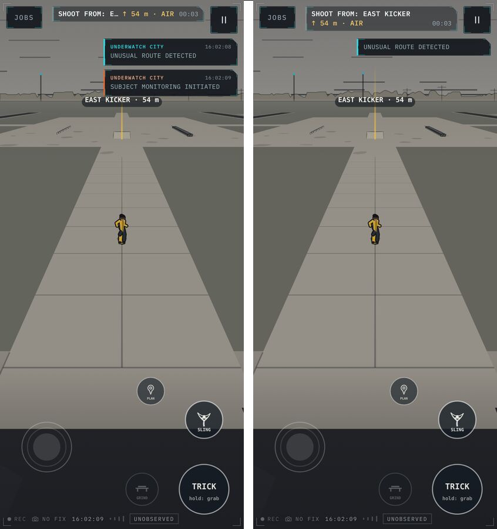
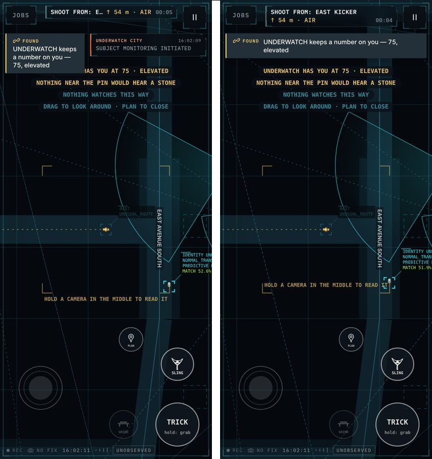
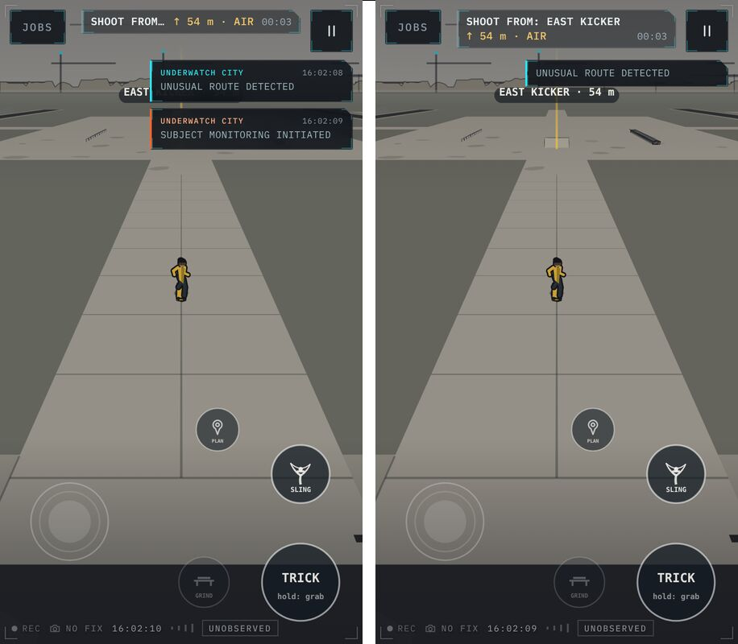
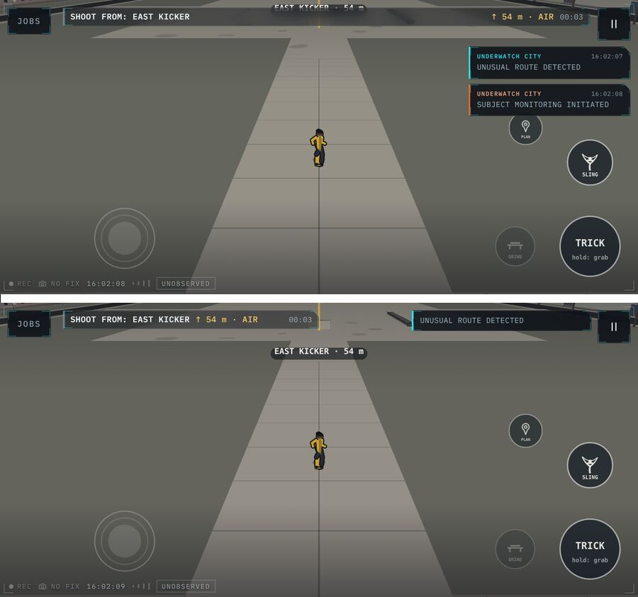
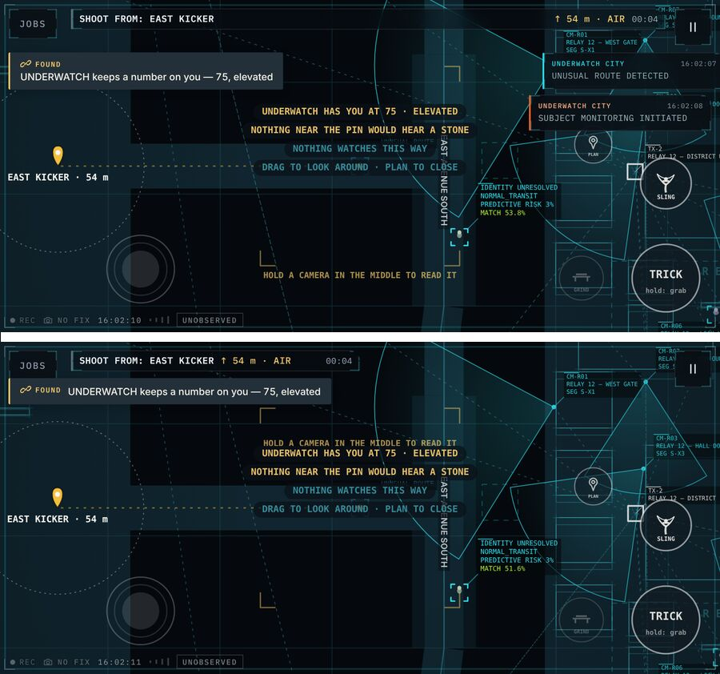
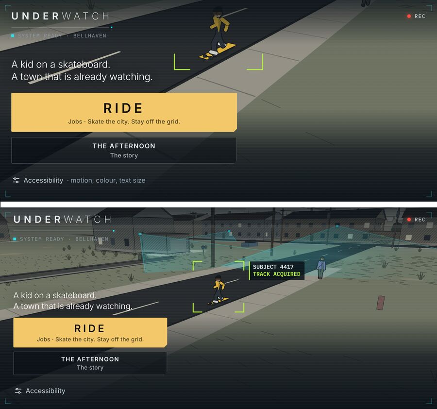

# 50 — The Top Band

A layout pass on the phone, and the browser checks that keep it. Nothing in
the game changed: no mechanic, no copy, no control. What changed is where
the interface puts things on a 393 × 852 glass, and on the same glass on its
side.

## What was wrong

Three things wanted the top of the glass at once — the job strip, the
town's cards, the notes' toasts — and on the plan, the plan's own readout.
Each was placed by a fixed offset that assumed the others were small.

- The strip shared one line between where you are going, the distance and
  the clock, and the name lost: `SHOOT FROM: E…`.
- In the first three seconds of a job two system cards stacked over the
  street ahead and landed on the destination's own label.
- On the plan, the cards and the FOUND toast sat on the readout.
- On its side, the strip stretched across the whole glass, the cards ran
  down the right edge into PLAN and SLING, and the title used the upright
  portrait: the kid cut off at the neck, RIDE a bar across half the screen.

## The rule

The band is the strip plus the corner buttons. Everything else starts under
the band's **measured** edge, never a guessed one.

- `JobHud` observes its own size and publishes `--band-bottom` (and the
  renderer's `hudTop`). Cards, toasts, the control hint, the in-world
  destination label and the plan readout all clamp under it, whether the
  strip is one line or four.
- The objective takes the line it needs, two at most; distance and clock
  wrap under it only when there is no room beside it.
- During a job on a phone, the town's card is a one-line ticker, one at a
  time. The strip already says how seen you are; the card is texture.
- With the plan open on a phone, the cards step back and a toast takes one
  full-width line. The readout has the top of the glass.
- On its side the band is one row: Jobs and a compact strip on the left,
  the card beside pause on the right, and the middle of the top edge left
  to the street — it is where the destination's label rises.

## The title on its side

Wider than tall gets the wide shot, as on a desktop, and a short landscape
screen gets a 300 px column. RIDE is 58 px tall and the afternoon 46 px:
still at or above a thumb's 44.

## Keeping it

`npm run test:e2e` drives the production build in Chromium as an iPhone,
an iPhone on its side, an iPhone SE and a desktop:

| Spec | What it holds |
| --- | --- |
| `e2e/visual.spec.ts` | Title, accessibility sheet, job board, brief and pause menu against baselines rendered on CI. The canvas is hidden, so only the interface is judged. |
| `e2e/a11y.spec.ts` | axe-core, WCAG 2.2 A/AA, on the same screens. Serious and critical fail. All pass. |
| `e2e/layout.spec.ts` | The run's geometry: the objective is never clipped; cards never touch the strip, corners or controls; one card during a job; none while the plan is open. Against the code before this pass it fails five checks. |

The baselines were rendered on CI from the design *before* this pass, so the
only screenshots this pass changed are the two it meant to: the title and the
accessibility sheet on a phone on its side.

## Limits

- No WebKit in the cloud image: the "iPhone" is Chromium with an iPhone's
  viewport, density, touch and user agent. Right for layout, not a
  substitute for Safari on a phone, and it cannot emulate the notch's
  safe-area insets (the CSS already reads `env(safe-area-inset-*)`).
- The canvas-drawn labels (the destination, the plan readout) are checked by
  eye in `scripts/flow-shots.mjs` captures, not by the layout spec, because
  the production build exposes no handle on the renderer.
- In landscape, a second simultaneous card is no longer shown (it already
  was not past two). The queue and its priorities are unchanged.
