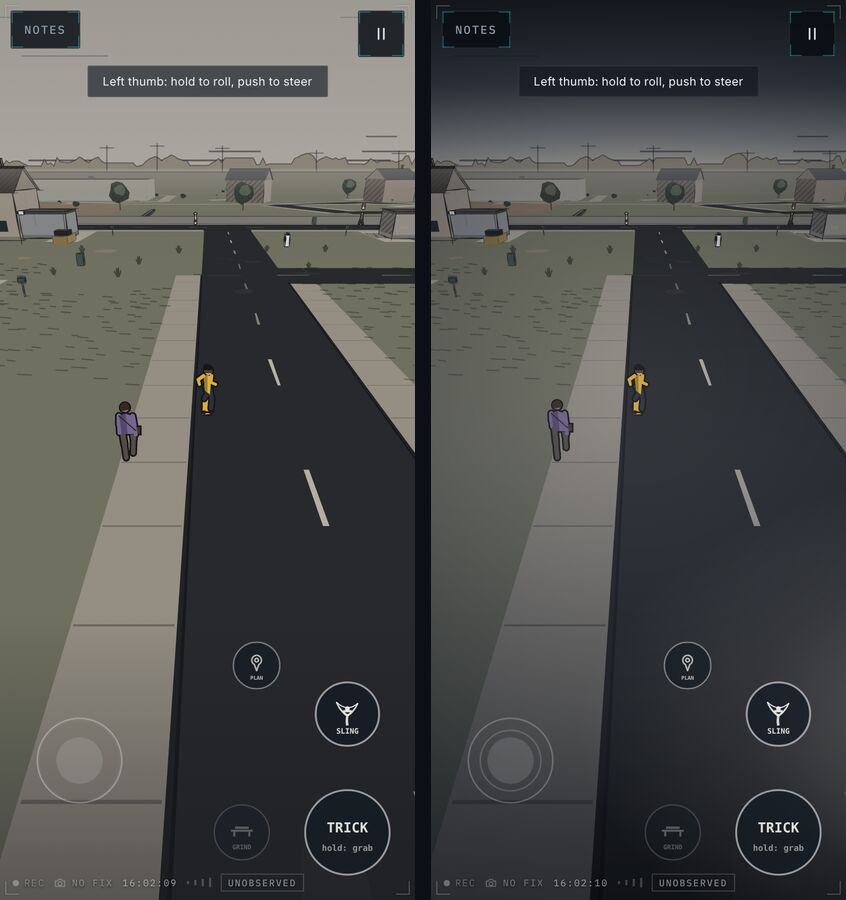
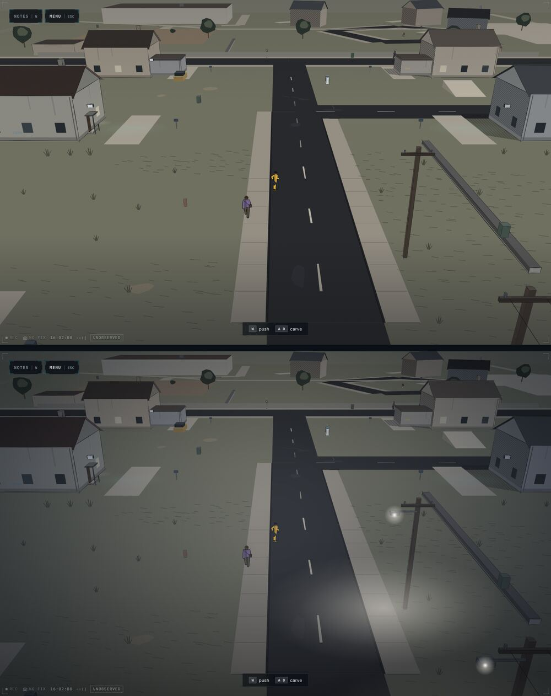
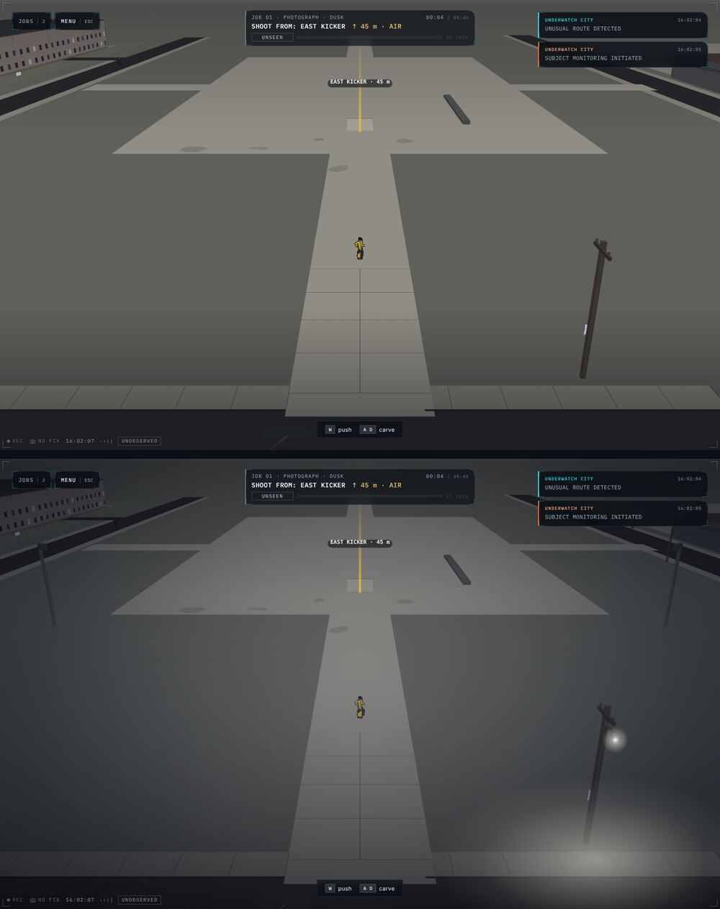
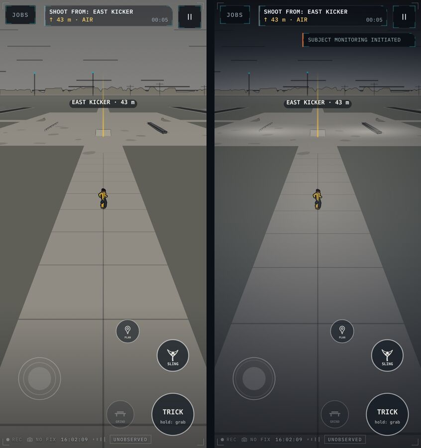
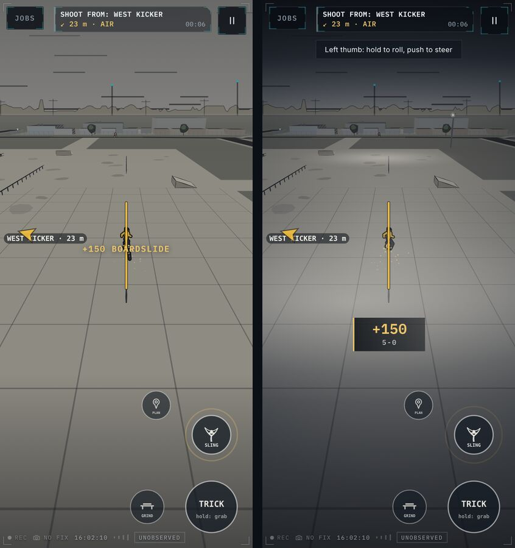
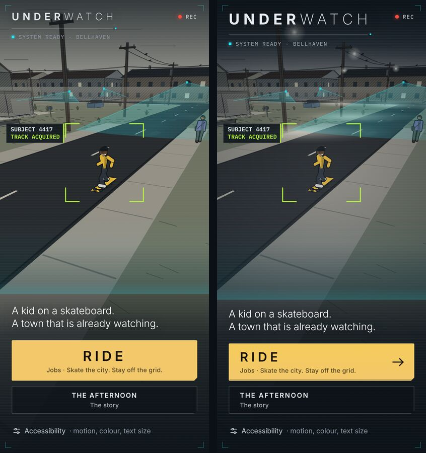
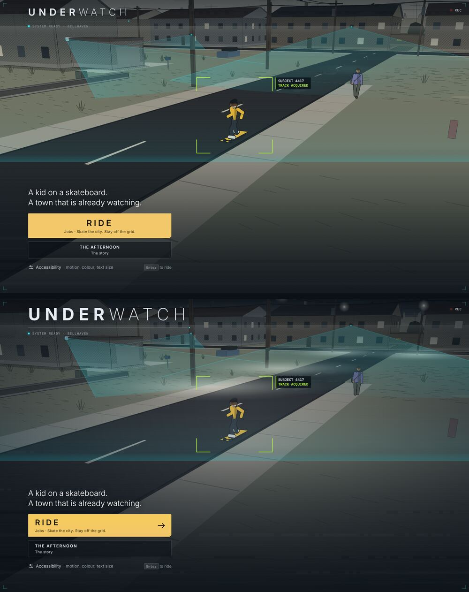
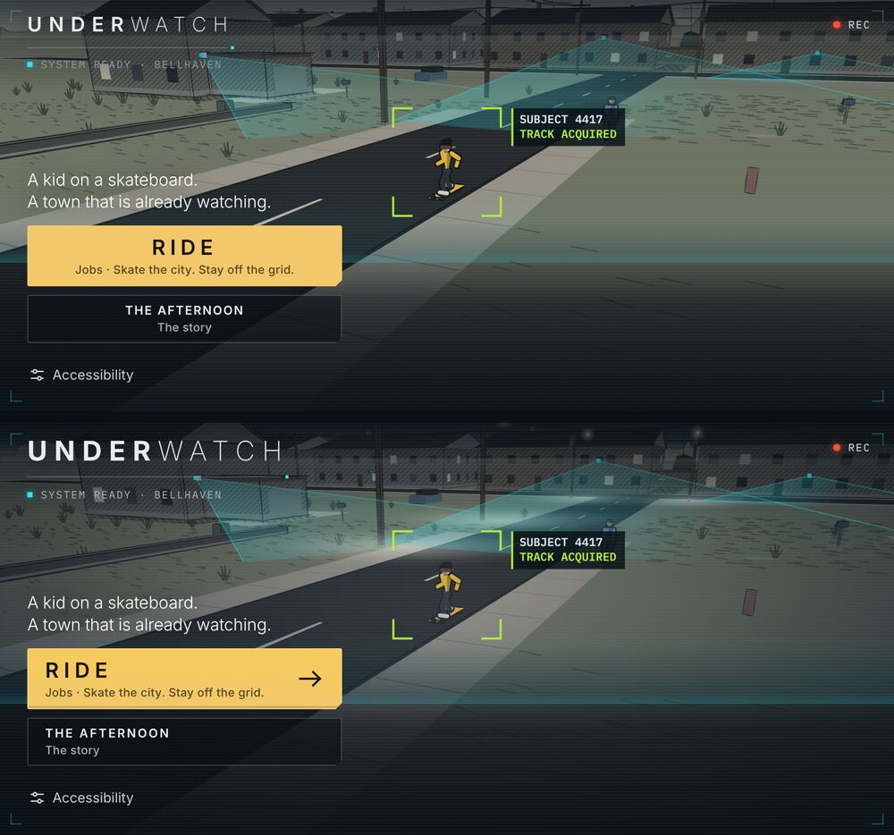
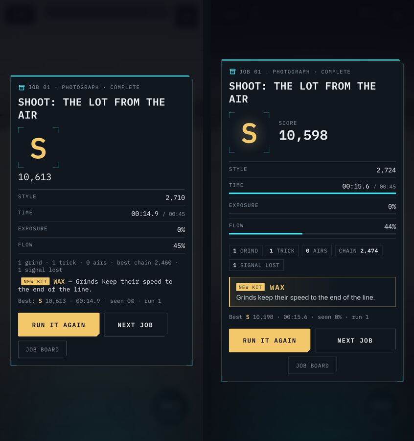
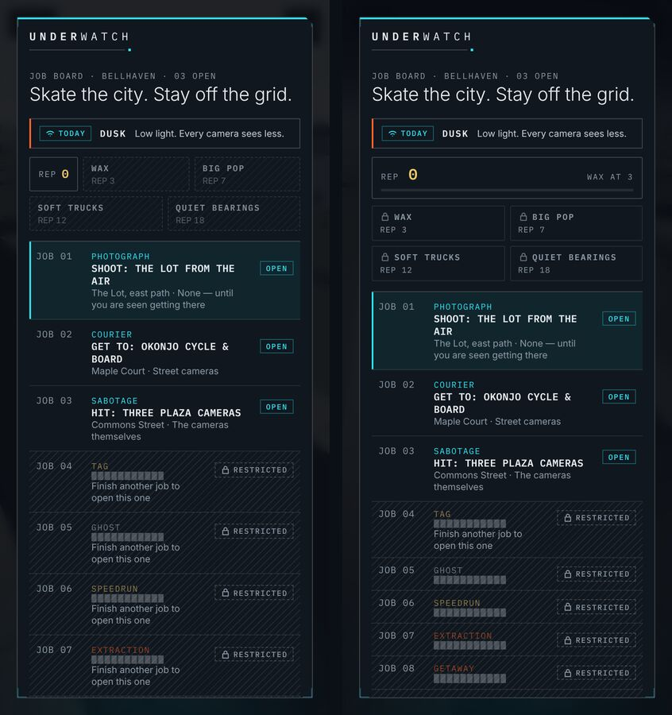

# 51 — Last Light

A visual renovation over the whole game: the town gets an evening, the
moves get an answer from the street, and the screens around a run read as
one instrument. No mechanic, scoring rule, job, control or line of story
changed.

## The five problems it started from

Captured from the running game with `scripts/tour.mjs` (iPhone, iPhone on
its side, desktop) before anything was touched:

1. **The Lot was a flat slab.** Where every first job is played: a large
   mid-grey pad under a flat pale sky, nothing lighter or darker in it, the
   rider a small low-contrast figure. Today's DUSK condition was invisible.
2. **No light anywhere.** `SKY`'s own comment promised "a dark slate lid,
   and a band of dirty light at the horizon"; its values were four shades
   of the same paper. Nothing in the street lit anything else.
3. **Moves landed silently.** A landing or a rail caught only shook the
   camera; the score was a line of mono text floating across the rider and
   the beacon's label.
4. **Results without ceremony.** A small grade over a list of plain rows,
   the kit it opened as an inline sentence, three mismatched buttons —
   RUN IT AGAIN wrapping onto two lines on an iPhone.
5. **A quiet first impression and a heavy board.** The name set like a
   label; RIDE a centred slab; the board's kit faint, and six restricted
   rows saying "Finish another job to open this one" six times.

## The direction

The brief asked for a premium night: deep shadows, controlled electric
highlights, strong silhouettes. UNDERWATCH's own record ([39](39-near-future-urban-noir.md)–[46](46-the-observation-system.md))
says the town is printed, not lit, and is *not* neon. Both hold: **the
print is kept and seen at last light.** Ink stays ink, paper stays paper,
the three signals keep their meanings; what is new is light.

## What changed

### The world (`perspective.ts`, `palette.ts` `SKY` and `LIGHT`)
- The sky climbs from the paper at the horizon through a cloud bank to a
  slate lid. Roofs, poles and the skyline read as silhouettes; the relay's
  cyan is the only colour up there. Owned lowers and darkens the lid.
- The ground falls from the horizon to slate under the thumbs, and a
  multiply pass takes the street down toward the edges of the glass except
  in a soft pool round the rider.
- Street lamps on the pole line, and four floodlights on the grass off the
  Lot's corners, screened on after the grade: paper-white, never the
  player's amber. The eight nearest are drawn.

### Feedback (`renderer.ts`, `jobs.ts`)
- A landing sends a ring of the player's amber across the ground, sized by
  speed, and throws dust. A rail caught rings and sparks; sparks keep
  coming off the trucks while the grind holds.
- The move plate: the points large, a multiplier tag, the move's name, on
  ink with an amber key — below the rider, above the thumbs.
- Stamp callouts sit on a band of ink, so they read over a floodlit pad.

### The interface (`styles.css`, `jobs.css`, `mobile.css`)
- Title: the name at the size of a title, and RIDE as a left-set action
  with an arrow.
- Results: grade and score as a hero; time, exposure and flow as measured
  bars; the tally as chips; new kit as an equipment card; two equal
  actions.
- The board: rep as a bar toward the next piece of kit; kit as equipment;
  restricted rows compact and saying how to open them once. The brief's GO
  takes the row.

## Checks

- `tests/art-direction.test.ts` holds `LIGHT` to the street's palette rules
  (muted, never a signal's hue) and stands the floodlights on bare ground,
  off every surface, building and feature.
- Draw cost (`scripts/shots.mjs`, phone viewport): 7.6–9.0 ms median after,
  8.3 ms before — within run-to-run noise; the ground's falloff is a
  source-over pass rather than a second blend for that reason.
- The visual baselines changed for the title, the accessibility sheet (its
  backdrop is the title), the board and the brief. The pause menu is
  pixel-identical.

## Still to do

- The Lot from the run's starting camera on an upright phone is the least
  changed frame: the floods light the pad, so it stays the lightest field
  on the glass. Darker concrete there would need the palette's skateable-
  ground rule revisited.
- The plan view and machine vision are untouched, deliberately — they are
  the system's register.
- Nothing here was checked on a real iPhone; Safari's canvas blend cost is
  expected to be lower than headless Chromium's, not measured.
