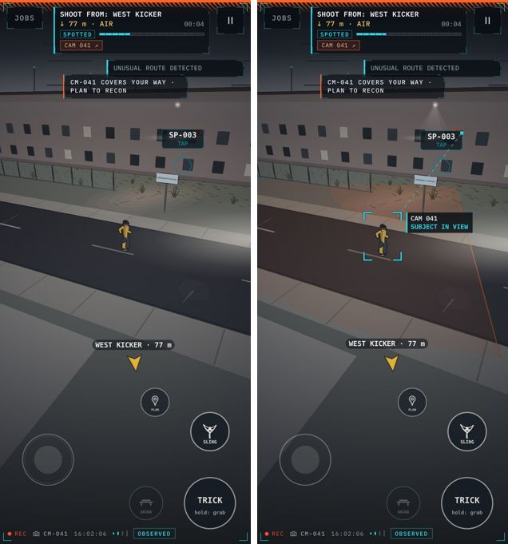
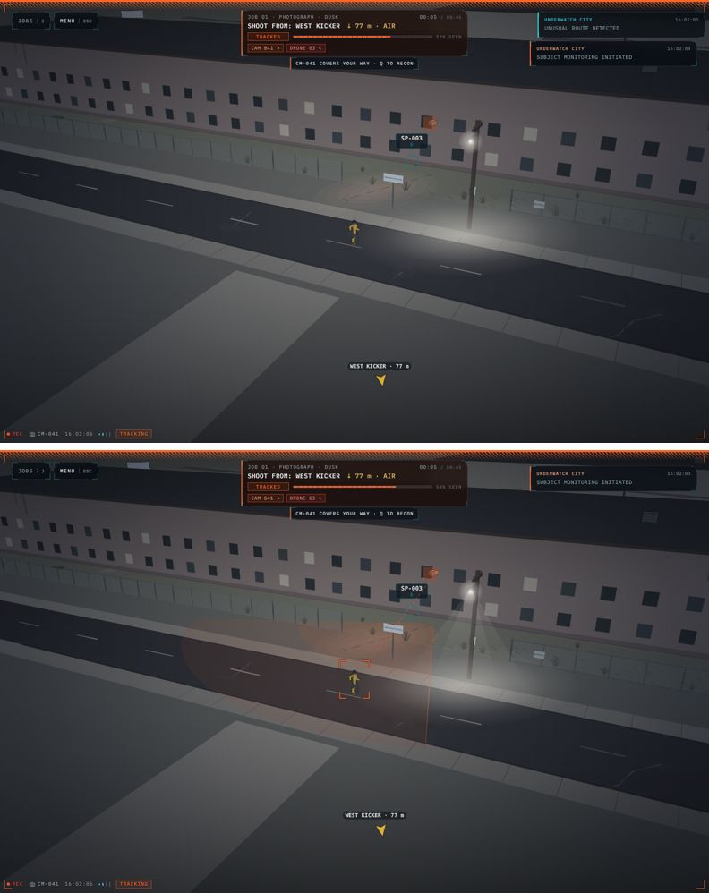
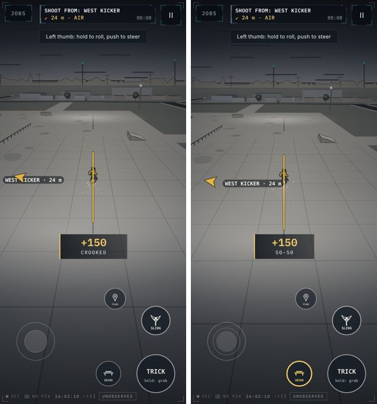
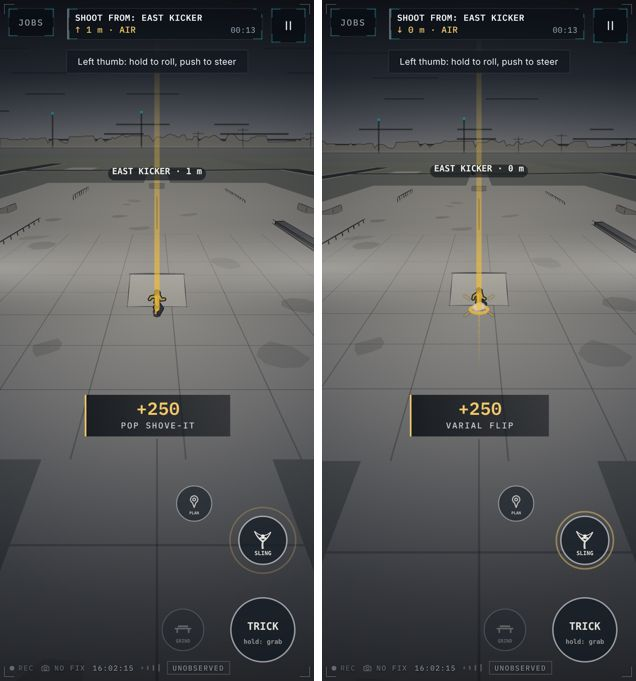
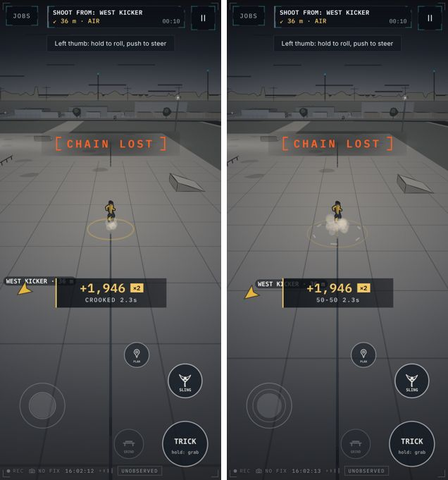
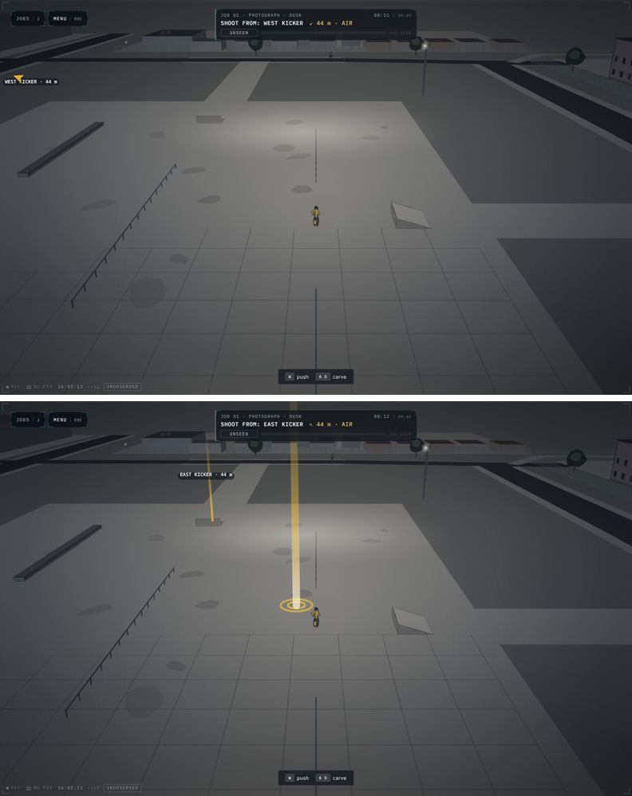
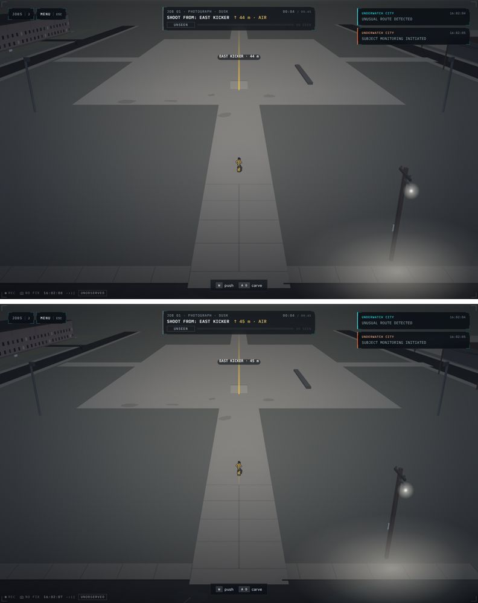

# 52 — The Watch in the Street

A visual-impact pass over play itself. The title promises *a kid on a
skateboard, a town that is already watching*, and draws it: real cones swept
across the street and a bracket that has already found the kid. In play, that
promise lived only in the plan view. This pass brings it into the street and
gives the moves an answer, without a new mechanic, scoring rule, control or
line of story. Every new mark is read off simulation state.

## What the audit found

Captured with `scripts/tour.mjs` and the new `scripts/impact-shots.mjs`
(iPhone viewport and desktop, headless Chromium) before anything changed:

1. **Being seen was abstract.** A lens's status light went orange and the
   strip said `CAM 041 ↗`, but nothing in the street said *which* camera,
   or *where* its picture was. The title's bracket never appeared in play.
2. **The street camera never moved.** `Renderer.kick()` shook the flat plan
   camera — which is not drawn while skating — so a landing, a rail caught or
   a slam had no camera response at all in third person. (docs/51 described
   landings as "only shook the camera"; in the street they did not.)
3. **A slam looked like nothing.** The bail's ripple is drawn only in the
   plan view; in the street it was an audio cue and the `CHAIN LOST` stamp.
4. **The beacon's label** was cut off at the glass edge when the beam stood
   near it, and the edge arrow was drawn through the name.
5. **Controls had two states** (pressed, dimmed). GRIND looked the same with
   a rail in reach as on it; TRICK said nothing while the board was flipping.
6. **The rider was small on an upright phone at rest** (about 40 CSS px).

Two things the brief asked for do not exist and were not invented: the sling
*line* (hook-and-swing traversal) was removed in [45](45-grinds-ramps-and-the-lot.md);
SLING is the slingshot, so its feedback here is the throw. There are no
"safe route" overlays in the game beyond the recon plan, so none were drawn.

## What changed

### The watch, on the ground (`src/render/watch.ts`, `perspective.ts collectWatch`)

`streetCones(sim)` decides which cameras' footprints are laid on the
street, under the same rule as the plan (`plan.ts`): **what the player
knows, never more.**

- A camera the player has noticed (`Sim.knownSensors`, or all with VISION)
  gets its footprint drawn within 70 m of the rider, six at most, nearest
  first, never longer than 24 m. Unnoticed cameras get nothing — recon is
  not undercut.
- A camera that has the rider right now is always drawn, known or not, in
  warning orange.
- A camera turned toward a stone is drawn in the player's amber: the turn is
  their doing.
- Timed by recon: firm edges. Only noticed: broken edges. So the recon's
  work is visible in the street the moment the plan is committed.

They are ground faces painted under the evening grade, so buildings stand
on them and the light falls on them like everything else.

### The bracket (`renderer.ts drawTrack`)

While `Sim.playerObserved` is true, the title's bracket closes on the kid in
the frame's rung colour (cyan in view, orange tracked, red live pursuit), a
fine dashed line runs from the lens that has them, and the lens's name sits
beside the bracket for two seconds after it first acquires. When the lens
loses them the bracket opens out and fades.

### Movement (`perspective.ts ChaseCamera.bump`, `renderer.ts`)

- **The rig answers.** `kick()` now also dips the street camera (down fast,
  back over a third of a second) and, for a slam, adds a short tremor.
  Scaled by the camera-shake setting; off entirely with reduced motion.
- **Speed lens.** The focal length opens up to 6.5 % as the board nears top
  speed, eased. Off with reduced motion and while drawing the sling.
- **The board's trail.** A thin amber ribbon of where the wheels have just
  been, only at speed or in the air, lifting with the board so an air draws
  its arc. A fixed ring of 18 samples in typed arrays: no per-frame allocation.
- **Framing.** On an upright phone at rest the rig sits at 26.5 m instead of
  29 m; with speed it still goes all the way out to the full miniature.

### Moves

- **Grind:** the rail glows amber from where the trucks bit to where they
  are, with a hot contact point under the board.
- **Trick:** the frame the feet catch the board, four amber ticks snap in
  round it (`player:trick` / `player:grab`).
- **Slam:** a broken ring of pale grit and a cloud of dust, not the amber of
  a move made (`player:bail`).
- **Sling:** a short white snap off the fork along the throw, for the
  tenth of a second before the stone's own streak can be seen.
- **Job point done:** two amber rings and the beam flaring up where it was.

### Controls and labels (`controls.ts`, `renderer.ts drawBeacon`)

- Four states: unavailable (dimmed), **available** (GRIND with a rail in
  reach: a thin amber ring, the same amber as the lit rail), **active** (on
  the rail, the board flipping or grabbed, the sling raised: amber rim and
  mark), pressed.
- The beacon's label is clamped inside the safe area, and set in from the
  edge arrow by its own half-width.

### Light

Street lamps away from the eye get a faint shaft of light from the housing
to their pool, in two widths for a soft edge. Lamps close to the eye are
skipped — up close it reads as a wall of light, not haze.

## Checks

- `tests/watch.test.ts`: no footprint for an unnoticed camera; every
  "seeing" footprint is a sensor the simulation says is seeing, tick by
  tick; a stone-turned camera reads as turned; a down camera is never drawn;
  footprints stay within their limits; the tag is read off state.
- Render cost, `renderer.render` median over 4 s, headless Chromium at an
  iPhone viewport, two runs each: on the Lot 5.6–6.2 ms before, 6.1–6.2 ms
  after; stood in front of a camera 8.2–9.2 ms before, 8.5 ms after. Within
  run-to-run noise.
- No console or page errors in either capture script.
- The visual baselines are unchanged: they mask the canvas, and no DOM
  interface changed.

## Still to do

- Not checked on a real iPhone; WebKit is not available in the cloud image.
- A thin pale horizontal line sometimes crosses the glass in the captures;
  it is in production too, its cause was not investigated, and it was left
  alone.
- The Lot is still the lightest field on the glass (docs/51's note stands).
